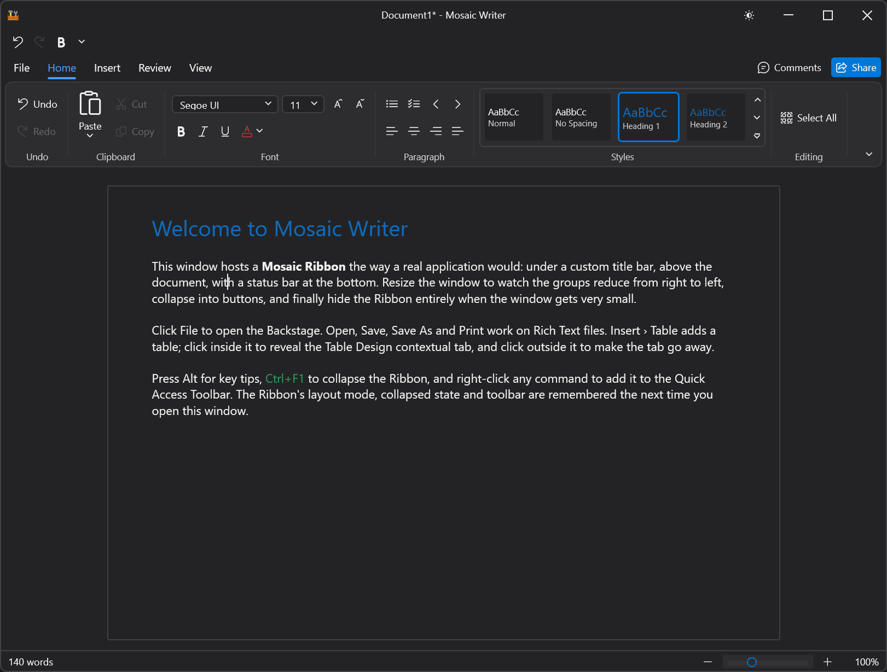

# Ribbon

A modern Office–style command Ribbon: task tabs and labeled groups, adaptive Classic and Simplified layouts, contextual tabs, a Backstage (File) view, a Quick Access Toolbar, key tips, screen tips, and persisted preferences. All colors come from theme tokens, so Light, Dark, Black, Blue and HighContrast all work.



The Quick Access Toolbar can share a normal window's title bar without a special window subclass.
Supply an empty, dedicated `ContentControl` in `WindowTitleBar.LeftContent`, then bind the Ribbon's
`QuickAccessToolbarHost` to it:

```xml
<mosaic:WindowTitleBar x:Name="TitleBar" TitleAlignment="Center">
    <mosaic:WindowTitleBar.LeftContent>
        <ContentControl Margin="4,0" />
    </mosaic:WindowTitleBar.LeftContent>
</mosaic:WindowTitleBar>

<mosaic:Ribbon QuickAccessToolbarHost="{Binding LeftContent, ElementName=TitleBar}" />
```

The host must be in the same window. The `Above` location uses this host; choosing `Below` moves the
same toolbar beneath the ribbon. Clearing `QuickAccessToolbarHost` restores internal hosting.
Set `ShowIcon="False"` on the title bar to reclaim the icon's space. See `RibbonDemoWindow.xaml`
for the complete window layout.

```xml
<mosaic:RibbonContainerPanel>
    <mosaic:Ribbon x:Name="Ribbon">
        <mosaic:Ribbon.Backstage>
            <mosaic:RibbonBackstage>
                <mosaic:RibbonBackstageTabItem Header="Home" Glyph="&#xE80F;">…</mosaic:RibbonBackstageTabItem>
                <mosaic:RibbonBackstageButton Content="Save" Glyph="&#xE74E;" Command="ApplicationCommands.Save" />
            </mosaic:RibbonBackstage>
        </mosaic:Ribbon.Backstage>

        <mosaic:RibbonTabItem Header="Home" mosaic:RibbonKeyTipService.KeyTip="H">
            <mosaic:RibbonGroup Header="Clipboard" Glyph="&#xE77F;">
                <mosaic:RibbonSplitButton Key="Paste" Label="Paste" Glyph="&#xE77F;" PreferredVariant="Large" Command="ApplicationCommands.Paste">
                    <mosaic:RibbonMenuItem Header="Keep Text Only" />
                </mosaic:RibbonSplitButton>
                <mosaic:RibbonButton Key="Cut" Label="Cut" Glyph="&#xE8C6;" Command="ApplicationCommands.Cut" />
            </mosaic:RibbonGroup>
        </mosaic:RibbonTabItem>
    </mosaic:Ribbon>

    <RichTextBox />  <!-- the document fills the remaining space; the Backstage covers both -->
</mosaic:RibbonContainerPanel>
```

Use `xmlns:mosaic="http://schemas.apexgate.net/wpf/mosaic-ui"` and merge a Mosaic ThemeManager into your resources.

## Command area and group styling

`Ribbon.Background`, `BorderBrush`, and `BorderThickness` style the outer ribbon, including the
tab strip. Use `BodyBackground`, `BodyBorderBrush`, `BodyBorderThickness`, `BodyMargin`, and
`BodyCornerRadius` to style the command area below the tabs. The same settings apply when the
minimized ribbon opens as a popup. The default command area uses the theme's ribbon brushes,
a one-DIP border, rounded corners, and an inset margin.

`RibbonGroup.Background`, `BorderBrush`, and `BorderThickness` style the group's command
content, including when that content opens from a collapsed group. `RibbonGroup.SeparatorBrush`
sets the brush for the vertical line after the group.

With the Black theme active, this gives the ribbon a flat background, a bottom rule, and vertical
group dividers:

```xml
<mosaic:Ribbon Background="Black"
               BodyBackground="Black"
               BodyBorderBrush="#30343A"
               BodyBorderThickness="0,0,0,1"
               BodyCornerRadius="0"
               BodyMargin="0">
    <mosaic:Ribbon.Resources>
        <Style TargetType="{x:Type mosaic:RibbonGroup}">
            <Setter Property="Background" Value="Transparent" />
            <Setter Property="SeparatorBrush" Value="#30343A" />
        </Style>
    </mosaic:Ribbon.Resources>
    <mosaic:RibbonTabItem Header="Game">
        <mosaic:RibbonGroup Header="Network">
            <mosaic:RibbonButton Label="Connect" Glyph="&#xE8CE;" />
        </mosaic:RibbonGroup>
    </mosaic:RibbonTabItem>
</mosaic:Ribbon>
```

**Commands.** `RibbonButton`, `RibbonToggleButton`, `RibbonCheckBox`, `RibbonMenuButton`, `RibbonSplitButton`, `RibbonMenuItem`, `RibbonComboBox`, `RibbonTextBox`, `RibbonGallery`, plus `RibbonControlGroup` (a row unit such as Bold/Italic/Underline) and `RibbonSeparator`. Give each command a unique, stable `Key`; keys (never labels) are used by the Quick Access Toolbar and persistence, and `Ribbon.ValidateKeys()` reports duplicates. Icons come from `LargeImage`/`SmallImage` or a font `Glyph` (Segoe Fluent Icons). The Ribbon is a focus scope, so routed commands route to the document's focused element, and mouse invocation returns focus to the document.

**MVVM.** Every command surface binds like standard WPF controls, and generated copies (overflow rows and Quick Access Toolbar buttons) share the source's state and command, so `CanExecute` disables all of them together.

- `RibbonButton`, `RibbonMenuItem` and `RibbonSplitButton` take `Command`/`CommandParameter`; `RibbonGroup` takes `LauncherCommand`.
- `RibbonToggleButton.IsChecked`, `RibbonCheckBox.IsChecked` and `RibbonComboBox.SelectedItem` bind two-way.
- A checkable `RibbonSplitButton` (`IsCheckable="True"`, `IsChecked` two-way) toggles its primary half before `Command` runs, like Bullets in Word.
- `RibbonGallery.Command` runs when the user picks an item (click, Enter, or a commit in the expanded view), with the picked item as the parameter unless `CommandParameter` is set. Programmatic selection never runs it.
- `RibbonTextBox.Command` runs on Enter, with the text as the parameter.
- `RibbonMenuButton` and `RibbonSplitButton` accept `ItemsSource` with `ItemContainerStyle`, `ItemTemplate` or `DisplayMemberPath`. Data-bound rows are mirrored into overflow and the Quick Access Toolbar with the same style.
- Menu items with `StaysOpenOnClick` keep their drop-down open.

```xml
<mosaic:Ribbon DataContext="{Binding Editor}">
    <mosaic:RibbonTabItem Header="Developer" Key="Developer">
        <mosaic:RibbonGroup Header="Build" LauncherCommand="{Binding OpenSettingsCommand}">
            <mosaic:RibbonButton Key="Build" Label="Build" Glyph="&#xE90F;" PreferredVariant="Large" Command="{Binding BuildCommand}" />
            <mosaic:RibbonComboBox Key="Config" Label="Config" ItemsSource="{Binding Configurations}" SelectedItem="{Binding Configuration}" />
            <mosaic:RibbonToggleButton Key="Watch" Label="Watch Mode" Glyph="&#xE7B3;" IsChecked="{Binding IsWatchMode}" />
        </mosaic:RibbonGroup>
        <mosaic:RibbonGroup Header="Debug">
            <mosaic:RibbonSplitButton Key="Break" Label="Exceptions" Glyph="&#xEBE8;" PreferredVariant="Large"
                                      IsCheckable="True" IsChecked="{Binding BreakOnExceptions}"
                                      ItemsSource="{Binding ExceptionFilters}" ItemContainerStyle="{StaticResource FilterItemStyle}" />
            <mosaic:RibbonButton Key="Attach" Label="Attach…" Glyph="&#xE71B;" mosaic:RibbonItem.CanAddToQuickAccessToolbar="False" />
        </mosaic:RibbonGroup>
        <mosaic:RibbonGroup Header="Appearance">
            <mosaic:RibbonGallery Key="Accent" Label="Accent" ItemsSource="{Binding Accents}" ItemTemplate="{StaticResource Swatch}"
                                  SelectedItem="{Binding SelectedAccent}" Command="{Binding ApplyAccentCommand}" />
        </mosaic:RibbonGroup>
        <mosaic:RibbonGroup Header="Find">
            <mosaic:RibbonTextBox Key="Search" Label="Search" Glyph="&#xE721;" Command="{Binding SearchCommand}" />
        </mosaic:RibbonGroup>
    </mosaic:RibbonTabItem>
</mosaic:Ribbon>
```

The demo's Ribbon example has a Developer tab built this way, backed by a view model with no Ribbon-specific code.

**Adaptive layout.** Each command has a `PreferredVariant` (`Large`, `Medium`, `Small`); the containing group or tab assigns the effective `Variant`. In Classic mode groups reduce right to left (medium, small, then collapse to a popup button), or in the order given by `RibbonTabItem.GroupVariants` (entries sharing a `SetName` apply together). Simplified mode shows one row; commands shrink and then move to the tab overflow menu or, with `ChildOverflowTarget="Group"`, to the group's own drop-down. `RibbonItem.CollapseBehavior` (`Never`/`Always`) and `RibbonItem.VariantBehavior` constrain this. Layout is a pure function of the available width, so it never oscillates; if required content still cannot fit, the group strip scrolls.

**Modes and size.** `LayoutMode`, `Density`, and `IsMinimized` are user preferences (the display-options button, the right-click menu, double-clicking a tab, and Ctrl+F1 change them). `IsCollapsed` is a temporary constraint: below `CollapseThresholdSize` the Ribbon hides without touching `IsMinimized`.

**Tabs.** Give tabs a `Key`. `FindTab(key)` returns a tab, and `SelectTab(key)` selects it only if it is visible and enabled; both fall back to the header text when a tab has no key. `SelectTab(tab)` throws for a tab that belongs to another Ribbon.

**Contextual tabs.** Add `RibbonContextualTabGroup`s to `ContextualTabGroups` and set `ContextualTabGroupKey` on tabs. Toggle `IsActive` to show them; when a selected contextual tab disappears the Ribbon selects a visible ordinary tab.

**Tab indicator.** When the selected tab changes, the accent underline (`PART_Indicator` in the `RibbonTabHeader` template) animates according to `TabIndicatorAnimation`: `Expand` (default) appears on the new tab at once, expands outward in both directions, then snaps back; `Slide` travels from the old tab, its leading edge stretching toward the new tab before the trailing edge catches up and snaps it to size (with no previous tab it grows from the center); `None` doesn't animate. Animations are skipped when Windows animations are turned off.

**Backstage.** `RibbonBackstage` covers the nearest `RibbonContainerPanel` (otherwise the window content) with an Office-style slide and fade (`OpenDuration`, `CloseDuration`, `IsAnimationEnabled`; Windows animation settings are honored). Focus is restored on close. `CanClose=false` disables the back button and Escape; `Ribbon.CloseBackstage()` (or `IsOpen=false`) still closes it from code.

**Quick Access Toolbar.** `AddToQuickAccessToolbar(key)` / `RemoveFromQuickAccessToolbar(key)`, `QuickAccessToolbarItemAdding` (cancellable), `QuickAccessToolbarLocation` (Above/Below), `QuickAccessToolbarMode` (None/Hidden/Visible), `QuickAccessToolbarShowLabels`. Users can also add commands from the right-click menu. QAT buttons are separate presentations bound to the source command's shared state. Set `mosaic:RibbonItem.CanAddToQuickAccessToolbar="False"` to keep a command off the toolbar: it isn't offered in the menu, and API calls and restored preferences skip it. The read-only `RibbonItem.IsInQuickAccessToolbar` is `true` on a source command while it is in the toolbar, so styles can react to it.

**Key tips.** Alt or F10 shows tips for File, tabs and the QAT; typing a tip activates it, opening nested scopes for tabs and drop-downs; Escape goes back one scope. Set `RibbonKeyTipService.KeyTip` to choose a tip; others are generated so that no tip is a prefix of another.

**Persistence.** `RibbonSerializer.SaveToFile`/`LoadFromFile` (or `Serialize`/`Deserialize`) store a versioned XML snapshot of mode, density, minimized state, the selected tab (by key) and the QAT. Restore after the Ribbon's commands exist (for example in `Loaded`). Malformed or newer-version input is ignored; unknown commands, unselectable tabs and invalid values are skipped with diagnostics in the returned `RibbonRestoreResult`. Input is treated as untrusted:

- DTDs and external resources are refused.
- Documents over `RibbonSerializer.MaxDocumentLength` characters are ignored.
- Read failures are reported as diagnostics.
- Saves write to a uniquely named temporary file and then swap it in.

**Validation.** Invalid values are rejected when they are set, rather than failing later during layout, and public methods throw `ArgumentNullException` and `ArgumentException` for bad arguments. Values that are rejected:

- Enum values that aren't defined.
- A non-positive or non-finite gallery `ItemWidth`/`ItemHeight`.
- Column counts below one.
- A negative `InputWidth` (`NaN` means automatic width).
- Negative Backstage durations.
- An empty `CollapseThresholdSize`.

Optional regions: `TabRowToolbarContent` (right end of the tab strip) and `FooterContent` (below the command card, for example a message bar). Root template parts: `PART_TabHeaderItemsControl`, `PART_ApplicationButton`, `PART_TabRowToolbarPresenter`, `PART_ItemsPresenter`, `PART_Body`, `PART_BodyHost`, `PART_MinimizedPopup`, `PART_MinimizedPopupHost`, `PART_QatAbovePresenter`, `PART_QatBelowPresenter`, `PART_FooterPresenter`, and `PART_DisplayOptionsButton`.
